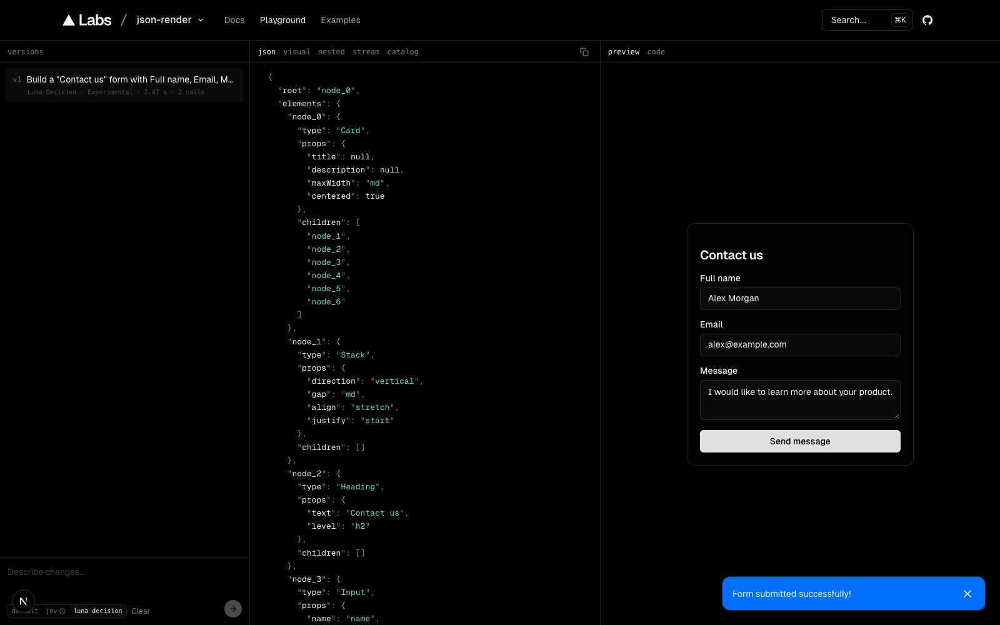

# json-render + EvoLink Luna Decision

Build interactive interfaces from natural-language requests using components, data and actions that your application controls.

This is [cheercheung's fork](https://github.com/cheercheung/json-render) of [Vercel Labs' json-render](https://github.com/vercel-labs/json-render). It adds an **EvoLink Luna Decision** evaluator and playground option alongside the original **default** and **Jev** modes. The upstream Apache-2.0 license and framework remain intact.

## Who is this for?

- **Developers building AI assistants** that need to return interactive forms, cards, charts and dashboards inside a conversation.
- **Product teams building adaptive interfaces** where the fields, sections or layout change with a user's request.
- **Developers evaluating decision models for UI composition** with explicit component choices, streamed previews and inspectable decisions.

You supply the component implementations, permitted actions and business data. The framework handles structured UI descriptions and rendering; a model helps decide which interface to show.

## Why use it?

For a fixed page, writing ordinary React components is usually simpler. json-render becomes useful when the interface needs to change with a request.

| Need | Without json-render | With json-render |
| --- | --- | --- |
| Turn a request into an interface | Write your own selection, layout and rendering protocol | Use a component catalog, a JSON spec and a renderer |
| Keep model output within your product | Build and validate your own output contract | Validate component names, props, bindings and structure against your catalog |
| Reuse existing design and interactions | Connect each generated view to your components | Register your components and permitted action handlers once |
| Show results while the model works | Implement progressive UI updates | Stream spec updates into the existing preview |

The **Luna mode in this fork** chooses from application-owned component candidates and arranges them. Application code assembles and validates the JSON; labels, validation rules and action bindings come from those candidates. It does not ask the decision model to generate arbitrary UI code or business logic.

```text
User request -> component and layout decisions -> validated JSON spec -> interactive UI
```

The default mode keeps the upstream generative-model flow. The framework also includes renderers for other web frameworks, mobile, PDF, email, video and terminal UIs; those integrations are documented in the [upstream reference](README.upstream.md).

## How to use

### 1. Clone and prepare the source build

The EvoLink evaluator is a **source addition in this fork**. Installing the published upstream npm packages alone does not install this integration.

Requirements: Node.js 24+, pnpm 11.1.3, and a globally available `portless` executable. The following tool versions were used for the local acceptance run:

```sh
npm install --global pnpm@11.1.3 portless@0.15.8

git clone https://github.com/cheercheung/json-render.git
cd json-render
pnpm install --frozen-lockfile --ignore-scripts
pnpm --filter web exec fumadocs-mdx
pnpm turbo run build --filter='web^...'
```

The install command skips dependency lifecycle scripts; the documentation generator and workspace dependency builds are run explicitly afterward. Keep the existing lockfile.

### 2. Configure the keys for the mode you want

Create the ignored local environment file **only if it does not already exist**:

```sh
[ -f apps/web/.env.local ] || cp apps/web/.env.example apps/web/.env.local
chmod 600 apps/web/.env.local
```

Open `apps/web/.env.local` in an editor. For **Luna Decision only**, set:

```dotenv
EVOLINK_API_KEY=your_evolink_api_key
```

[Get an EvoLink API key](https://evolink.ai). Keep the real value in `.env.local` or the server's environment, never in the example file or browser code.

| Mode / feature | Environment variables | When required |
| --- | --- | --- |
| **luna decision** | `EVOLINK_API_KEY` | Required for Luna UI composition. No Gateway or TypeSafe key is needed for this mode. |
| **default** | `AI_GATEWAY_API_KEY` | Required for local development of the original generative-model mode. Vercel deployments can use the upstream Gateway authentication flow. |
| **jev** | `JEV_AI_GATEWAY_API_KEY` | A dedicated **Vercel AI Gateway key**, required for the Jev playground mode. The Gateway account must allow `typesafe-ai/jev`. |
| Default model override | `AI_GATEWAY_MODEL` | Optional; affects default mode only. The source default is `anthropic/claude-haiku-4.5`. |
| Shared rate limiting | `KV_REST_API_URL`, `KV_REST_API_TOKEN` | Optional pair for the existing Redis-backed request limits. Without the pair, the local demo uses no-op rate limiters. |
| Rate limit settings | `RATE_LIMIT_PER_MINUTE`, `RATE_LIMIT_PER_DAY` | Optional; default to 10 and 100 when rate limiting is configured. |

You only need the key for the selected mode. Luna and Jev use separate credentials and do not automatically fall back to another provider. Leave unused credentials blank. None of these keys belongs in a `NEXT_PUBLIC_` variable. Restart the dev server after changing environment variables.

### 3. Start the playground

```sh
PORTLESS_HTTPS=0 PORTLESS_PORT=1355 PORTLESS_SYNC_HOSTS=0 \
  PORTLESS_STATE_DIR="$PWD/.cache/portless" pnpm --filter web dev
```

This uses plain HTTP and a task-local proxy state directory, avoiding local certificate or hosts-file setup. Open the URL printed by portless, normally **http://json-render.localhost:1355/playground**. If port 1355 already belongs to another proxy, select a different proxy port with `PORTLESS_PORT`.

Select **luna decision** before sending the request. The page initially selects **default**, which uses its own Gateway credentials.

Try this English task:

> Build a "Contact us" form with Full name, Email, Message, and a "Send message" button. Require all fields and validate email.

Check that the form appears, an empty submission shows required-field errors, an invalid email is rejected, and valid inputs show a success notification. Form submission is a local validation/toast demo. To actually send messages or save records, implement and authorize the corresponding backend actions.

### 4. Use the evaluator in your own app

Build this fork's packages and use its source-built core package with a compatible renderer. Keep all `@json-render/*` packages on matching versions and record the fork commit; the upstream package version alone does not identify this experimental addition.

```ts
// Server only. Supply your own catalog and candidate recipes.
import {
  experimental_composeSpec,
  experimental_createEvoLinkEvaluator,
} from "@json-render/core";
import { catalog, candidates } from "./your-ui-catalog";

const evaluate = experimental_createEvoLinkEvaluator({
  apiKey: process.env.EVOLINK_API_KEY ?? "",
});

for await (const event of experimental_composeSpec({
  catalog,
  candidates,
  prompt: "Build a contact form",
  evaluate,
  signal: AbortSignal.timeout(55_000),
})) {
  if (event.spec) {
    // Send each validated spec snapshot to your client-side renderer.
  }
}
```

[Read the evaluator configuration and package instructions](EVOLINK_LOCAL.md). [Explore the playground's candidate recipes](apps/web/lib/jev/grammar.ts). [Read the original framework API and renderer reference](README.upstream.md).

## Recorded example



[Watch the complete English contact-form test](docs/media/luna-contact-form.mp4) (31.76 seconds, original speed, no cuts).

The recorded run on 2026-10-22 finished composition in **2.471 seconds**, with **2 evaluator calls** and **11,840 reported input tokens**. Required fields, invalid email and the valid-submission notification passed. These are observations from one local acceptance run, not a latency benchmark or a price comparison. Actual billing was not verified.

[Read the validation results and known limitations](docs/evolink-validation.md).

## Limits and development checks

- The Luna playground supports the prepared candidates in `grammar.ts`; arbitrary new fields, prose, data or styles need application-supplied candidates or the default generative mode.
- Selecting a valid component tree does not guarantee that the model understood every request. Inspect the preview and decisions, and test against your own task set.
- The playground uses synthetic data and demo action handlers. Business integrations, authentication, permissions and deployment are application responsibilities.
- `experimental_` APIs can change. This fork has not published a separate npm release.
- Full monorepo type checking has a known unchanged `packages/react-pdf/src/render.tsx:173` TS2740 error. Related Web/core checks and 87 focused offline tests passed; see the validation notes.

From the repository root, run the focused tests without an API key:

```sh
pnpm exec vitest run \
  packages/core/src/experimental-evolink-evaluator.test.ts \
  packages/core/src/experimental-evaluator.test.ts \
  packages/core/src/experimental-compose.test.ts \
  apps/web/lib/jev \
  apps/web/lib/use-playground-stream.test.ts
pnpm --filter web check-types
pnpm type-check
```

The upstream npm publishing workflow is restricted to `vercel-labs/json-render`; pushing to this fork does not publish the upstream packages.

## Source and license

Fork maintained by cheercheung, based on upstream commit `72568f990e5502c4d3115691facb8ca928a5c9fc`. [Inspect the source provenance](EVOLINK_SOURCE.json), [read the original upstream README](README.upstream.md), and [read the Apache-2.0 license](LICENSE).
